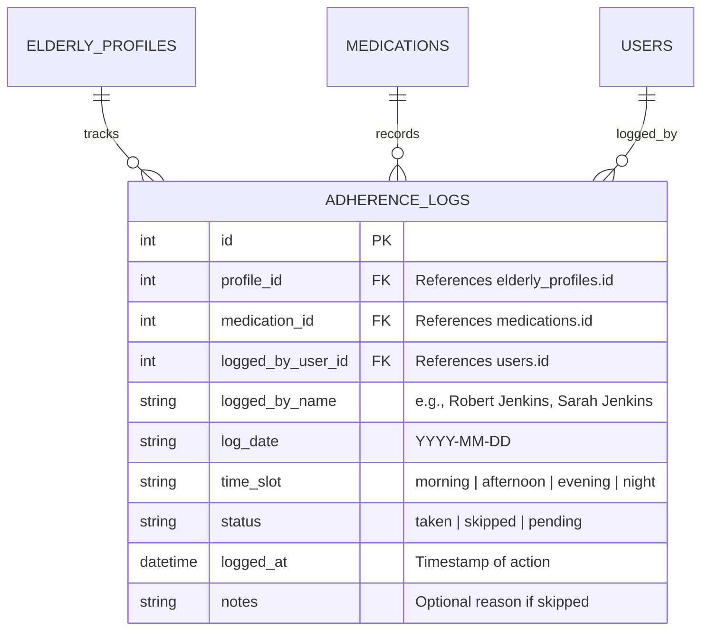

# Current Work Specification: Part 4 (Daily Adherence Checklist & Real-Time Logging)

---

## 1. Objective & Scope

This document defines the complete technical and functional specification for **Part 4: Daily Adherence Checklist & Real-Time Logging** of the Elderly Care & Medication Management Platform.

### Key Goals:
1. Provide a **live "Today's Medication Routine" checklist** matching scheduled medications with their real-time adherence state.
2. Enable **1-click status updates** for elderly users and caregivers:
   * **Taken ✅** — Automatically logs the exact timestamp (e.g., *Taken at 08:14 AM*) and records who logged it.
   * **Skipped ⏭️** — Logs dose as skipped with optional quick reason (*"Feeling unwell"*, *"Doctor advised"*, *"Ran out of pills"*).
   * **Undo / Reset ↺** — Allows reversing an accidental click back to *Pending*.
3. **Daily Compliance Progress Bar:**
   * Live visual progress (e.g., *"3 of 4 doses taken today — 75%"*).
   * Motivational feedback (*"Great job, Grandpa Robert! All morning doses complete"*).
4. **Accountability & Audit Logging:**
   * Clearly records *who* logged the dose (`logged_by_name`: *"Grandpa Robert"* vs *"Nurse Elena"* vs *"Sarah Jenkins"*).
5. **7-Day Historical Adherence Streak:**
   * Daily compliance history for caregivers and family to monitor trends and spot missed dose patterns.
6. **Permission Controls:**
   * `senior`, `family`, and `caregiver` have full rights to log doses.
   * `other` (read-only viewers) can view the checklist and compliance progress, but buttons are disabled/hidden.

---

## 2. Domain & Entity Architecture



---

## 3. Database Schema (SQLAlchemy Model)

File: `backend/app/models/adherence.py`

```python
from datetime import datetime
from sqlalchemy import Column, Integer, String, DateTime, ForeignKey, UniqueConstraint
from sqlalchemy.orm import relationship
from app.database import Base

class AdherenceLog(Base):
    __tablename__ = "adherence_logs"

    id = Column(Integer, primary_key=True, index=True)
    profile_id = Column(Integer, ForeignKey("elderly_profiles.id", ondelete="CASCADE"), nullable=False, index=True)
    medication_id = Column(Integer, ForeignKey("medications.id", ondelete="CASCADE"), nullable=False, index=True)
    logged_by_user_id = Column(Integer, ForeignKey("users.id", ondelete="SET NULL"), nullable=True)
    
    logged_by_name = Column(String(100), nullable=False)   # "Robert Jenkins" or "Nurse Elena"
    log_date = Column(String(20), nullable=False, index=True) # "YYYY-MM-DD"
    time_slot = Column(String(20), nullable=False)         # 'morning', 'afternoon', 'evening', 'night'
    status = Column(String(20), nullable=False, default="taken") # 'taken', 'skipped'
    logged_at = Column(DateTime, default=datetime.utcnow)
    notes = Column(String(255), nullable=True)             # e.g., "Felt dizzy", "Doctor asked to pause"

    profile = relationship("ElderlyProfile", backref="adherence_logs")
    medication = relationship("Medication", backref="adherence_logs")
    user = relationship("User")

    __table_args__ = (
        UniqueConstraint("profile_id", "medication_id", "log_date", "time_slot", name="uq_profile_med_date_slot"),
    )
```

---

## 4. Pydantic Schemas (Request / Response)

File: `backend/app/schemas/adherence.py`

```python
from datetime import datetime
from typing import Optional, List, Dict
from pydantic import BaseModel, ConfigDict, Field

class AdherenceLogCreate(BaseModel):
    profile_id: int
    medication_id: int
    status: str = Field(..., pattern="^(taken|skipped)$")
    log_date: Optional[str] = None # Defaults to today (YYYY-MM-DD)
    time_slot: str = Field(..., pattern="^(morning|afternoon|evening|night)$")
    notes: Optional[str] = None

class AdherenceLogResponse(BaseModel):
    model_config = ConfigDict(from_attributes=True)

    id: int
    profile_id: int
    medication_id: int
    logged_by_name: str
    log_date: str
    time_slot: str
    status: str
    logged_at: datetime
    notes: Optional[str] = None

class TodayDoseItem(BaseModel):
    medication_id: int
    name: str
    dosage: str
    time_slot: str
    exact_time: str
    instructions: Optional[str] = None
    purpose: Optional[str] = None
    pill_shape: Optional[str] = "Round"
    pill_color: Optional[str] = "White"
    status: str = "pending" # 'pending', 'taken', 'skipped'
    log_id: Optional[int] = None
    logged_at: Optional[datetime] = None
    logged_by_name: Optional[str] = None
    notes: Optional[str] = None

class TodayAdherenceSummary(BaseModel):
    date: str
    profile_id: int
    total_doses: int
    taken_count: int
    skipped_count: int
    pending_count: int
    compliance_percentage: int
    slots: Dict[str, List[TodayDoseItem]]

class DayComplianceStat(BaseModel):
    date: str
    day_name: str # "Mon", "Tue", etc.
    total: int
    taken: int
    skipped: int
    percentage: int

class WeeklyAdherenceHistory(BaseModel):
    profile_id: int
    average_compliance: int
    days: List[DayComplianceStat]
```

---

## 5. REST API Endpoints Specification

Base URL: `http://localhost:8000/api/adherence`

### 1. `GET /api/adherence/today?profile_id={id}&target_date={YYYY-MM-DD}`
Returns today's medication routine with real-time adherence state for each dose.
* **Logic:**
  1. Queries all active medications for `profile_id`.
  2. Queries `adherence_logs` for `log_date = target_date` (defaults to today).
  3. Matches each medication to its log. If logged, status is `taken` or `skipped`; if not logged, status is `pending`.
  4. Calculates `compliance_percentage` = `(taken_count / total_doses) * 100`.
* **Response (200 OK):** `TodayAdherenceSummary`.

### 2. `POST /api/adherence/log`
Records a dose as `taken` or `skipped`.
* **Authorization:** Caller must belong to the circle and cannot be `other` (read-only).
* **Behavior:**
  * Uses `upsert` logic: If a log already exists for this medication today, updates status, timestamp, and notes. Otherwise, inserts new log.
* **Request Body:** `AdherenceLogCreate`
* **Response (200 OK):** `AdherenceLogResponse`.

### 3. `DELETE /api/adherence/reset/{log_id}`
Reverts a logged dose back to `pending` (undo accidental click).
* **Authorization:** Caller must belong to the circle and cannot be `other`.
* **Response (200 OK):** `{"success": true, "message": "Dose reset to pending."}`.

### 4. `GET /api/adherence/history?profile_id={id}&days=7`
Returns past 7-day adherence breakdown for the caregiver compliance chart.
* **Response (200 OK):** `WeeklyAdherenceHistory`.

---

## 6. Frontend Architecture & UI Design

### 6.1 Today's Live Checklist Component (`TodayAdherenceChecklist.tsx`)
```
┌────────────────────────────────────────────────────────────────────────┐
│  TODAY'S ROUTINE — Sunday, Nov 15                                      │
│  Progress: 3 of 4 Doses Taken (75%)                                    │
│  [██████████████████████████████████████░░░░░░░░░░░░] 75%              │
├────────────────────────────────────────────────────────────────────────┤
│                                                                        │
│  🌅 MORNING                                                            │
│  ┌──────────────────────────────────────────────────────────────────┐  │
│  │ 💊 Metformin (500 mg) • 08:00 AM                                 │  │
│  │    Instructions: Take with food after breakfast                  │  │
│  │    ✅ TAKEN at 08:14 AM by Grandpa Robert           [ ↺ Undo ]    │  │
│  └──────────────────────────────────────────────────────────────────┘  │
│                                                                        │
│  ☀️ AFTERNOON                                                          │
│  ┌──────────────────────────────────────────────────────────────────┐  │
│  │ 💊 Vitamin D3 (1000 IU) • 01:00 PM                               │  │
│  │    Instructions: Take with lunch                                 │  │
│  │    ✅ TAKEN at 01:05 PM by Nurse Elena              [ ↺ Undo ]    │  │
│  └──────────────────────────────────────────────────────────────────┘  │
│                                                                        │
│  🌇 EVENING                                                            │
│  ┌──────────────────────────────────────────────────────────────────┐  │
│  │ 💊 Lisinopril (10 mg) • 07:00 PM                                 │  │
│  │    Instructions: Take with dinner and full glass of water        │  │
│  │    [ ✅ I Took This ]          [ ⏭️ Skip Dose ]                  │  │
│  └──────────────────────────────────────────────────────────────────┘  │
│                                                                        │
│  🌙 BEDTIME                                                            │
│  ┌──────────────────────────────────────────────────────────────────┐  │
│  │ 💊 Atorvastatin (20 mg) • 09:30 PM                               │  │
│  │    Instructions: Take right before sleep                         │  │
│  │    [ ✅ I Took This ]          [ ⏭️ Skip Dose ]                  │  │
│  └──────────────────────────────────────────────────────────────────┘  │
└────────────────────────────────────────────────────────────────────────┘
```

### 6.2 7-Day Adherence Streak Card (`WeeklyStreakCard.tsx`)
Displays compliance percentage pills for the last 7 days:
`[Mon: 100%] [Tue: 100%] [Wed: 75%] [Thu: 100%] [Fri: 100%] [Sat: 100%] [Today: 75%]`

---

## 7. Step-by-Step Implementation Plan

### Step 1: Backend Implementation
- [ ] Create `backend/app/models/adherence.py` (`AdherenceLog` model).
- [ ] Register in `backend/app/models/__init__.py`.
- [ ] Create `backend/app/schemas/adherence.py`.
- [ ] Create `backend/app/routers/adherence.py`:
  - `GET /api/adherence/today`
  - `POST /api/adherence/log`
  - `DELETE /api/adherence/reset/{log_id}`
  - `GET /api/adherence/history`
- [ ] Register router in `backend/app/main.py`.
- [ ] Update `backend/app/utils/seeder.py` to seed sample adherence logs for the last 7 days so compliance charts are immediately populated.
- [ ] Run automated API tests for adherence logging, undo, and read-only blocking.

### Step 2: Frontend Implementation
- [ ] Add adherence TypeScript interfaces in `frontend/src/lib/types.ts`.
- [ ] Add adherence API methods in `frontend/src/lib/api.ts` (`getTodayAdherence`, `logDose`, `resetDose`, `getAdherenceHistory`).
- [ ] Build `TodayAdherenceChecklist.tsx` with:
  - 1-click **"I Took This"** and **"Skip"** buttons.
  - Live progress bar with completion percentage.
  - Undo button.
- [ ] Build `SkipDoseModal.tsx` for entering skip reason.
- [ ] Build `WeeklyStreakCard.tsx` showing 7-day compliance history.
- [ ] Integrate into `frontend/src/app/page.tsx` right above Medication Schedule.

---

## 8. Verification & Test Plan

1. **Automated Backend Tests:**
   * Query today's routine for Grandpa Robert (4 total doses, all initially `pending`).
   * Mark Morning Metformin as `taken` -> verify `taken_count = 1`, `compliance = 25%`.
   * Mark Afternoon Vitamin D as `skipped` -> verify `skipped_count = 1`.
   * Reset Morning Metformin -> verify it returns to `pending`.
   * Verify read-only viewer Neighbor Tom is blocked from logging doses (`403 Forbidden`).
2. **Frontend UI Tests:**
   * Open `http://localhost:3000`.
   * Click **"I Took This ✅"** on morning dose:
     * Card turns emerald green.
     * Timestamp badge appears: *"Taken at HH:MM by Sarah Jenkins"*.
     * Progress bar updates from 0% to 25%.
   * Click **"↺ Undo"** -> Card reverts to pending.
