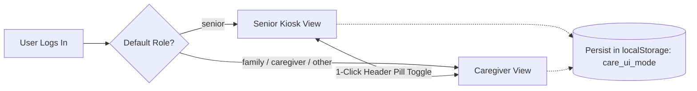

# Part 7: Dual-Mode UI (Elderly Kiosk View vs. Caregiver Management View)

---

## 1. Objective & Scope

This document specifies **Part 7: Dual-Mode UI** of the Elderly Care & Medication Management Platform.

### The Problem Solved:
Elderly individuals often struggle with complex, feature-rich dashboards containing dense tables, multiple modals, medical jargon, and small buttons. At the same time, family members and nurses need rich analytics, prescription editing, appointment calendars, and care circle oversight.

### Solution: Dual-Mode Adaptive Interface
A 1-click toggle switches the platform between two specialized operating modes:

1. **👴 Senior Kiosk Mode (Elderly View):**
   * **Giant Touch Targets (80px+):** Accessible for seniors with tremors, arthritis, or low digital literacy.
   * **Ultra-High Contrast & Large Typography (24px–36px):** Designed for vision impairment and reading glasses.
   * **Zero Clutter:** Strips away tabs, editing forms, prescription histories, and technical settings.
   * **3-Second Core Loop:** Shows only the next immediate dose with a giant `[ ✅ I TOOK THIS ]` button and a 1-tap `[ 📞 CALL SARAH ]` emergency button.
   * **Audio / Motivational Feedback:** Pleasant confirmation sound or voice cue upon marking a dose.

2. **👩 Caregiver Mode (Family & Professional View):**
   * Complete multi-senior profile switcher.
   * Full medication CRUD (add/edit/delete dosages, timings, shapes, colors).
   * Adherence progress bar & 7-day historical compliance streak.
   * Medical appointments calendar, preparation guidelines, and completion tracking.
   * Universal 6-digit circle code sharing and notification preferences.

---

## 2. Mode State & Persistence Architecture



---

## 3. UI Wireframe: Senior Kiosk Mode

```
┌────────────────────────────────────────────────────────────────────────┐
│  CareCircle                  [ 🔄 Switch to Caregiver View ]  [ 🚪 ]   │
├────────────────────────────────────────────────────────────────────────┤
│                                                                        │
│   👋 Good Morning, Grandpa Robert!                                     │
│   Sunday, November 15                                                  │
│                                                                        │
│   ┌────────────────────────────────────────────────────────────────┐   │
│   │                                                                │   │
│   │   💊  TIME FOR YOUR MORNING MEDICINE                           │   │
│   │                                                                │   │
│   │   METFORMIN                                                    │   │
│   │   500 mg • White Oval Pill                                     │   │
│   │   Take after breakfast with water                              │   │
│   │                                                                │   │
│   │   ┌────────────────────────────────────────────────────────┐   │   │
│   │   │                                                        │   │   │
│   │   │             ✅  I TOOK THIS MEDICINE                   │   │   │
│   │   │                                                        │   │   │
│   │   └────────────────────────────────────────────────────────┘   │   │
│   │                                                                │   │
│   └────────────────────────────────────────────────────────────────┘   │
│                                                                        │
│   ┌────────────────────────────────────────────────────────────────┐   │
│   │  🚨 NEED HELP?                                                 │   │
│   │  [ 📞 Call Daughter Sarah (555-0199) ]                         │   │
│   └────────────────────────────────────────────────────────────────┘   │
│                                                                        │
└────────────────────────────────────────────────────────────────────────┘
```

---

## 4. Technical Implementation Plan

1. **Context & State (`frontend/src/context/UIModeContext.tsx`):**
   * Mode: `'elderly' | 'caregiver'`
   * `toggleMode()` and `setMode(mode)`
   * Persisted in `localStorage.getItem('care_ui_mode')`
   * Automatically defaults to `'elderly'` when `user.default_role === 'senior'`.
2. **Component (`frontend/src/components/elderly/SeniorKioskView.tsx`):**
   * Massive touch card for the next pending dose.
   * Giant `[ ✅ I TOOK THIS ]` button with tactile pulse feedback.
   * 1-tap Emergency Call card linking to `tel:${emergency_phone}`.
3. **Header Mode Switcher:**
   * Prominent pill button in top bar: `[ 👴 Senior View ]` ⟷ `[ 👩 Caregiver View ]`.
