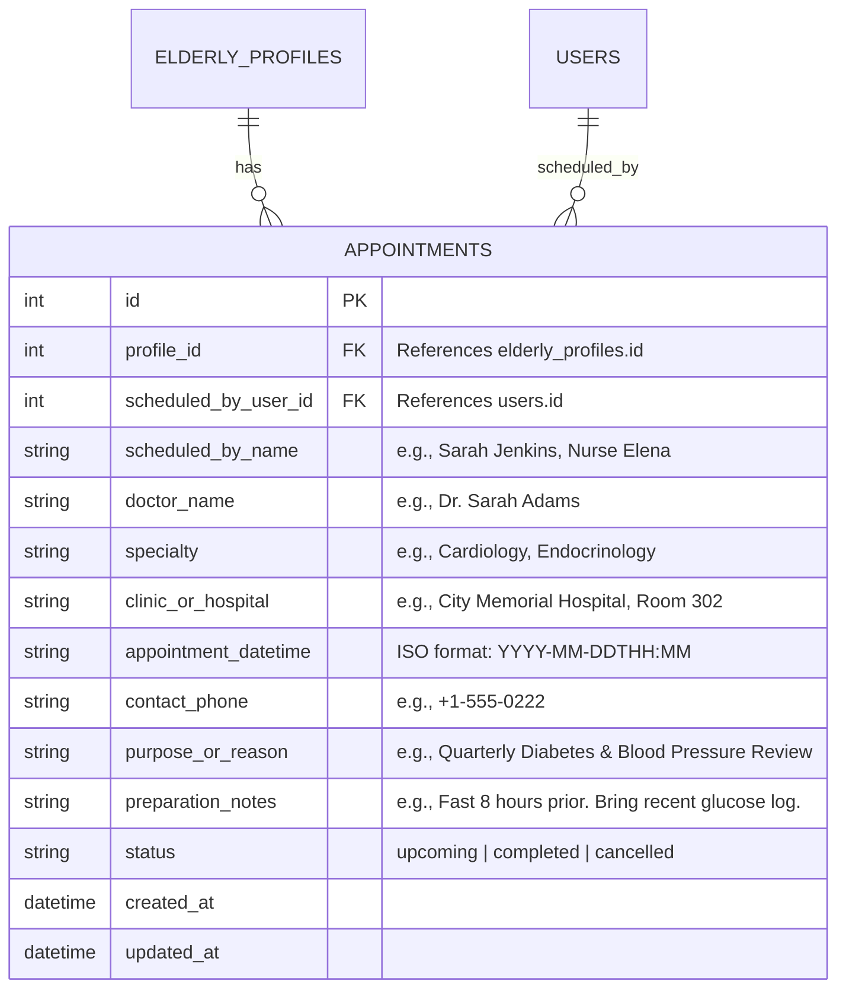

# Current Work Specification: Part 5 (Medical Appointments Management)

---

## 1. Objective & Scope

This document defines the complete technical and functional specification for **Part 5: Medical Appointments Management** of the Elderly Care & Medication Management Platform.

### Core Problem Solved:
Elderly seniors frequently manage multiple chronic conditions (e.g., Diabetes, Hypertension, Osteoarthritis, Glaucoma) requiring regular consultations with different medical specialists (Cardiologists, Endocrinologists, Ophthalmologists, Physiotherapists). 
Seniors and their family members frequently forget upcoming appointment dates, clinic room locations, preparation guidelines (e.g. fasting before blood draws, bringing recent ECGs), and doctor contact information.

### Key Goals & Features:
1. **Appointment Scheduling & Tracking (CRUD):**
   * Schedule, view, update, and cancel appointments with doctor name, medical specialty, clinic/hospital address, contact phone, and consultation date/time.
2. **Specialized Preparation & Pre-Visit Notes:**
   * Record vital pre-visit instructions (e.g., *"Fast for 10 hours prior to consultation"*, *"Bring recent lipid panel & prescription bottles"*).
3. **Smart Time Badges & Countdown:**
   * Dynamic urgency indicators:
     * 🔴 *"Today at 10:30 AM"*
     * 🟠 *"Tomorrow at 02:00 PM"*
     * 🟢 *"In 3 days (Nov 18)"*
     * ⚪ *"Completed"* / ❌ *"Cancelled"*
4. **Appointment Status Lifecycle:**
   * `upcoming` → `completed` → `cancelled`.
   * 1-click status update (`Mark as Completed ✅`, `Cancel Visit ❌`).
5. **Care Circle Collaboration & Accountability:**
   * Any authorized care circle member (`senior`, `family`, `caregiver`) can schedule or modify visits.
   * Clearly shows who scheduled or updated the appointment.
   * `other` (read-only viewers) can view the calendar and preparation instructions, but mutating actions are disabled.
6. **Chronological Sorting & Categorization:**
   * Grouped into **Upcoming Appointments** (sorted nearest first) and **Past Consultations History**.

---

## 2. Domain & Entity Architecture



---

## 3. Database Schema (SQLAlchemy Model)

File: `backend/app/models/appointment.py`

```python
from datetime import datetime
from sqlalchemy import Column, Integer, String, DateTime, ForeignKey, Text
from sqlalchemy.orm import relationship
from app.database import Base

class Appointment(Base):
    __tablename__ = "appointments"

    id = Column(Integer, primary_key=True, index=True)
    profile_id = Column(Integer, ForeignKey("elderly_profiles.id", ondelete="CASCADE"), nullable=False, index=True)
    scheduled_by_user_id = Column(Integer, ForeignKey("users.id", ondelete="SET NULL"), nullable=True)

    scheduled_by_name = Column(String(100), nullable=False)   # Name of creator
    doctor_name = Column(String(120), nullable=False)         # "Dr. Sarah Adams"
    specialty = Column(String(100), nullable=False)           # "Cardiologist", "Endocrinologist", etc.
    clinic_or_hospital = Column(String(200), nullable=False)  # "City Memorial Hospital, Suite 4B"
    appointment_datetime = Column(String(30), nullable=False, index=True) # "2026-11-18T10:30"
    
    contact_phone = Column(String(40), nullable=True)         # Clinic desk phone
    purpose_or_reason = Column(String(255), nullable=True)    # "Quarterly Diabetes Check"
    preparation_notes = Column(Text, nullable=True)           # "Fasting required 8 hours prior"
    status = Column(String(20), nullable=False, default="upcoming") # "upcoming", "completed", "cancelled"

    created_at = Column(DateTime, default=datetime.utcnow)
    updated_at = Column(DateTime, default=datetime.utcnow, onupdate=datetime.utcnow)

    profile = relationship("ElderlyProfile", backref="appointments")
    user = relationship("User")
```

---

## 4. Pydantic Schemas (Request / Response)

File: `backend/app/schemas/appointment.py`

```python
from datetime import datetime
from typing import Optional, List
from pydantic import BaseModel, ConfigDict, Field

class AppointmentCreate(BaseModel):
    profile_id: int
    doctor_name: str = Field(..., min_length=2, max_length=120)
    specialty: str = Field(..., min_length=2, max_length=100)
    clinic_or_hospital: str = Field(..., min_length=2, max_length=200)
    appointment_datetime: str = Field(..., pattern=r"^\d{4}-\d{2}-\d{2}T\d{2}:\d{2}(:\d{2})?$") # ISO format
    contact_phone: Optional[str] = None
    purpose_or_reason: Optional[str] = None
    preparation_notes: Optional[str] = None

class AppointmentUpdate(BaseModel):
    doctor_name: Optional[str] = None
    specialty: Optional[str] = None
    clinic_or_hospital: Optional[str] = None
    appointment_datetime: Optional[str] = None
    contact_phone: Optional[str] = None
    purpose_or_reason: Optional[str] = None
    preparation_notes: Optional[str] = None
    status: Optional[str] = Field(None, pattern="^(upcoming|completed|cancelled)$")

class AppointmentResponse(BaseModel):
    model_config = ConfigDict(from_attributes=True)

    id: int
    profile_id: int
    scheduled_by_name: str
    doctor_name: str
    specialty: str
    clinic_or_hospital: str
    appointment_datetime: str
    contact_phone: Optional[str] = None
    purpose_or_reason: Optional[str] = None
    preparation_notes: Optional[str] = None
    status: str
    created_at: datetime
    updated_at: datetime

class AppointmentListSummary(BaseModel):
    upcoming: List[AppointmentResponse]
    past_or_completed: List[AppointmentResponse]
    total_upcoming: int
```

---

## 5. REST API Endpoints Specification

Base URL: `http://localhost:8000/api/appointments`

### 1. `GET /api/appointments?profile_id={id}&status={upcoming|completed|cancelled|all}`
* **Description:** Retrieves appointments for the specified elderly profile.
* **Query Parameters:**
  * `profile_id` (int, required): Target senior profile.
  * `status` (string, optional, default "all"): Filter by status.
* **Authorization:** Caller must belong to the profile's care circle.
* **Sorting:** Upcoming visits sorted ascending by date (nearest first); completed/past visits sorted descending.
* **Response (200 OK):** `AppointmentListSummary` or `List[AppointmentResponse]`.

### 2. `POST /api/appointments`
* **Description:** Schedules a new medical appointment.
* **Authorization:** Circle member with non-`other` role (`senior`, `family`, `caregiver`).
* **Request Body:** `AppointmentCreate`
* **Response (201 Created):** `AppointmentResponse`.

### 3. `GET /api/appointments/{id}`
* **Description:** Retrieves detailed information for a single appointment.
* **Authorization:** Circle member of the appointment's senior profile.
* **Response (200 OK):** `AppointmentResponse`.

### 4. `PUT /api/appointments/{id}`
* **Description:** Updates appointment details or changes status (`upcoming`, `completed`, `cancelled`).
* **Authorization:** Circle member with non-`other` role.
* **Request Body:** `AppointmentUpdate`
* **Response (200 OK):** `AppointmentResponse`.

### 5. `DELETE /api/appointments/{id}`
* **Description:** Permanently deletes an appointment record.
* **Authorization:** Circle member with non-`other` role.
* **Response (200 OK):** `{"success": true, "message": "Appointment deleted successfully."}`.

---

## 6. Frontend Architecture & UI Design

### 6.1 Appointments Dashboard Section (`AppointmentsSection.tsx`)

```
┌────────────────────────────────────────────────────────────────────────┐
│  🩺 MEDICAL APPOINTMENTS                               [ + Schedule ]  │
│  Upcoming Doctor Consultations & Hospital Visits                       │
├────────────────────────────────────────────────────────────────────────┤
│  [ Upcoming (2) ]     [ Past & Completed (4) ]                         │
├────────────────────────────────────────────────────────────────────────┤
│                                                                        │
│  ┌──────────────────────────────────────────────────────────────────┐  │
│  │ 🔴 IN 2 DAYS • Wednesday, Nov 18 at 10:30 AM                     │  │
│  │ Dr. Sarah Adams — Cardiologist                                   │  │
│  │ 🏥 City Memorial Hospital, Suite 402                             │  │
│  │ 📞 +1-555-0222    👤 Scheduled by Sarah Jenkins                  │  │
│  │                                                                  │  │
│  │ Purpose: 6-Month Hypertension & ECG Follow-up                    │  │
│  │ ⚠️ PREPARATION NOTES:                                            │  │
│  │ Fast for 8 hours prior. Bring daily blood pressure log.          │  │
│  │                                                                  │  │
│  │ [ ✅ Mark Completed ]       [ ✏️ Edit ]       [ ❌ Cancel ]       │  │
│  └──────────────────────────────────────────────────────────────────┘  │
│                                                                        │
│  ┌──────────────────────────────────────────────────────────────────┐  │
│  │ 🟢 NEXT WEEK • Tuesday, Nov 24 at 02:00 PM                       │  │
│  │ Dr. Michael Chen — Endocrinologist                               │  │
│  │ 🏥 Springfield Diabetes & Wellness Center                        │  │
│  │                                                                  │  │
│  │ Purpose: HbA1c Lab Review & Medication Adjustment                │  │
│  │                                                                  │  │
│  │ [ ✅ Mark Completed ]       [ ✏️ Edit ]       [ ❌ Cancel ]       │  │
│  └──────────────────────────────────────────────────────────────────┘  │
└────────────────────────────────────────────────────────────────────────┘
```

### 6.2 Modals
1. `ScheduleAppointmentModal.tsx`:
   * Doctor Name (`Dr. Sarah Adams`)
   * Specialty dropdown (`Cardiology`, `Endocrinology`, `General Physician`, `Ophthalmology`, `Dentistry`, `Neurology`, `Orthopedics`, etc.)
   * Hospital / Clinic name & address
   * Date & Time picker
   * Contact Phone
   * Purpose of consultation
   * Preparation instructions (e.g. fasting, prior tests to bring)
2. `EditAppointmentModal.tsx`:
   * Allows modifying any field or toggling status (`upcoming`, `completed`, `cancelled`).

---

## 7. Pre-Seeded Demo Data

For **Grandpa Robert Jenkins** (`882104`):
1. **Upcoming:**
   * **Doctor:** Dr. Sarah Adams (Cardiologist)
   * **Date:** 3 days from now at 10:30 AM
   * **Hospital:** City Memorial Hospital, Heart Care Wing Room 302
   * **Purpose:** Routine Blood Pressure & ECG Assessment
   * **Notes:** Fast 8 hours prior. Bring recent blood pressure log and medication list.
2. **Completed (Past):**
   * **Doctor:** Dr. Robert Vance (Optometrist)
   * **Date:** 14 days ago
   * **Hospital:** West Valley Eye Clinic
   * **Purpose:** Glaucoma screening & reading glasses renewal
   * **Status:** `completed`

For **Grandma Alice Jenkins** (`994821`):
1. **Upcoming:**
   * **Doctor:** Dr. Michael Chen (Endocrinologist)
   * **Date:** 5 days from now at 02:00 PM
   * **Hospital:** St. Jude Medical Center, Room 105
   * **Purpose:** Thyroid function & Calcium levels review

---

## 8. Automated Test Plan (`test_appointments_api.py`)

1. **Test 1:** Unauthenticated request rejected (401 Unauthorized).
2. **Test 2:** Circle member can list appointments for Grandpa Robert.
3. **Test 3:** Schedule new appointment (Dr. Adams, Cardiology) -> 201 Created.
4. **Test 4:** Retrieve single appointment by ID -> 200 OK.
5. **Test 5:** Update appointment preparation notes -> 200 OK.
6. **Test 6:** Mark appointment as `completed` -> 200 OK.
7. **Test 7:** List grouped appointments (verifies upcoming vs completed partition).
8. **Test 8:** Read-only `other` role (Neighbor Tom) blocked from creating or editing appointments (403 Forbidden).
9. **Test 9:** Delete appointment -> 200 OK.
10. **Test 10:** Cross-profile isolation (Alice's appointments are strictly isolated from Robert's).

---

## 9. Definition of Done (Deliverables)

* [ ] `backend/app/models/appointment.py` implemented and registered in `backend/app/models/__init__.py`.
* [ ] `backend/app/schemas/appointment.py` implemented and exported in `backend/app/schemas/__init__.py`.
* [ ] `backend/app/routers/appointment.py` implemented with all 5 REST endpoints and role verification.
* [ ] Registered in `backend/app/main.py`.
* [ ] `backend/app/utils/seeder.py` seeded with realistic appointments for Robert & Alice.
* [ ] `backend/test_appointments_api.py` passing 10/10 automated tests.
* [ ] Frontend types and API methods added in `frontend/src/lib/types.ts` & `frontend/src/lib/api.ts`.
* [ ] Frontend components: `AppointmentsSection.tsx`, `ScheduleAppointmentModal.tsx`, `EditAppointmentModal.tsx`.
* [ ] Integrated into `frontend/src/app/page.tsx`.
