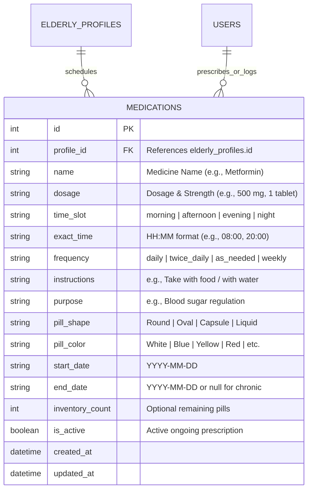

# Current Work Specification: Part 3 (Medication Schedule Management - CRUD)

---

## 1. Objective & Scope

This document defines the complete technical and functional specification for **Part 3: Medication Schedule Management (CRUD)** of the Elderly Care & Medication Management Platform.

### Key Goals:
1. Allow authorized members (`senior`, `family`, `caregiver`) to **view, add, edit, and delete medications** for the active elderly profile.
2. Enforce **read-only protection** for `other` (viewers can see the full schedule, but cannot alter prescriptions).
3. Structure schedules into intuitive, elderly-friendly **Daily Time Slots**:
   * 🌅 **Morning** (e.g., 08:00 AM / Breakfast)
   * ☀️ **Afternoon** (e.g., 01:00 PM / Lunch)
   * 🌇 **Evening** (e.g., 07:00 PM / Dinner)
   * 🌙 **Night / Bedtime** (e.g., 09:30 PM / Sleep)
4. Capture rich medication metadata that matters to seniors and doctors:
   * **Intake Instructions:** *"Take with food"*, *"Take on an empty stomach"*, *"Take with full glass of water"*, *"Avoid grapefruit"*.
   * **Clinical Purpose:** *"Blood pressure control"*, *"Type 2 Diabetes"*, *"Cholesterol"*.
   * **Visual Pill Identifier:** Pill shape (*Round*, *Oval*, *Capsule*, *Liquid*) and color (*White*, *Blue*, *Yellow*, *Pink*) so elderly users recognize their pills immediately!
5. Strict **Profile Isolation:** All medication schedules belong strictly to `profile_id`, ensuring zero cross-contamination between seniors.

---

## 2. Domain & Entity Architecture



---

## 3. Database Schema (SQLAlchemy Model)

File: `backend/app/models/medication.py`

```python
from datetime import datetime
from sqlalchemy import Column, Integer, String, Text, Boolean, DateTime, ForeignKey
from sqlalchemy.orm import relationship
from app.database import Base

class Medication(Base):
    __tablename__ = "medications"

    id = Column(Integer, primary_key=True, index=True)
    profile_id = Column(Integer, ForeignKey("elderly_profiles.id", ondelete="CASCADE"), nullable=False, index=True)
    
    # Core Identity
    name = Column(String(120), nullable=False)           # e.g., "Metformin"
    dosage = Column(String(60), nullable=False)          # e.g., "500 mg" or "1 tablet"
    
    # Schedule & Timing
    time_slot = Column(String(20), nullable=False)       # 'morning', 'afternoon', 'evening', 'night'
    exact_time = Column(String(10), default="08:00")     # e.g., "08:00", "13:00", "19:00", "21:30"
    frequency = Column(String(40), default="daily")      # 'daily', 'twice_daily', 'as_needed', 'weekly'
    
    # Medical Guidance & Instructions
    instructions = Column(String(255), nullable=True)    # e.g., "Take with food", "Take before breakfast"
    purpose = Column(String(150), nullable=True)         # e.g., "Type 2 Diabetes", "Blood Pressure"
    
    # Visual Pill Aids (High accessibility for seniors)
    pill_shape = Column(String(30), default="Round")     # 'Round', 'Oval', 'Capsule', 'Liquid'
    pill_color = Column(String(30), default="White")     # 'White', 'Blue', 'Yellow', 'Pink', 'Red'
    
    # Prescription Duration & Inventory
    start_date = Column(String(20), nullable=True)       # e.g., "2026-11-15"
    end_date = Column(String(20), nullable=True)         # null means ongoing chronic medication
    inventory_count = Column(Integer, nullable=True)     # e.g., 30
    
    is_active = Column(Boolean, default=True)            # Soft delete flag
    created_at = Column(DateTime, default=datetime.utcnow)
    updated_at = Column(DateTime, default=datetime.utcnow, onupdate=datetime.utcnow)

    profile = relationship("ElderlyProfile", backref="medications")
```

---

## 4. Pydantic Schemas (Request / Response)

File: `backend/app/schemas/medication.py`

```python
from datetime import datetime
from typing import Optional, List
from pydantic import BaseModel, ConfigDict, Field

class MedicationCreate(BaseModel):
    profile_id: int
    name: str = Field(..., min_length=2, max_length=120, example="Metformin")
    dosage: str = Field(..., min_length=1, max_length=60, example="500 mg")
    time_slot: str = Field(..., example="morning") # 'morning', 'afternoon', 'evening', 'night'
    exact_time: Optional[str] = Field("08:00", example="08:00")
    frequency: Optional[str] = Field("daily", example="daily")
    instructions: Optional[str] = Field("Take with food", example="Take with food")
    purpose: Optional[str] = Field(None, example="Blood sugar management")
    pill_shape: Optional[str] = Field("Round", example="Round")
    pill_color: Optional[str] = Field("White", example="White")
    start_date: Optional[str] = None
    end_date: Optional[str] = None
    inventory_count: Optional[int] = None

class MedicationUpdate(BaseModel):
    name: Optional[str] = None
    dosage: Optional[str] = None
    time_slot: Optional[str] = None
    exact_time: Optional[str] = None
    frequency: Optional[str] = None
    instructions: Optional[str] = None
    purpose: Optional[str] = None
    pill_shape: Optional[str] = None
    pill_color: Optional[str] = None
    start_date: Optional[str] = None
    end_date: Optional[str] = None
    inventory_count: Optional[int] = None
    is_active: Optional[bool] = None

class MedicationResponse(BaseModel):
    model_config = ConfigDict(from_attributes=True)

    id: int
    profile_id: int
    name: str
    dosage: str
    time_slot: str
    exact_time: str
    frequency: str
    instructions: Optional[str] = None
    purpose: Optional[str] = None
    pill_shape: Optional[str] = "Round"
    pill_color: Optional[str] = "White"
    start_date: Optional[str] = None
    end_date: Optional[str] = None
    inventory_count: Optional[int] = None
    is_active: bool
    created_at: datetime
    updated_at: datetime

class SlotGroupedMedications(BaseModel):
    morning: List[MedicationResponse]
    afternoon: List[MedicationResponse]
    evening: List[MedicationResponse]
    night: List[MedicationResponse]
```

---

## 5. REST API Endpoints Specification

Base URL: `http://localhost:8000/api/medications`

### 1. `GET /api/medications?profile_id={id}`
Returns all active medications for the senior, sorted by time slot.
* **Authorization:** Caller must belong to the care circle of `profile_id`.
* **Response (200 OK):** Array of `MedicationResponse`.

### 2. `GET /api/medications/grouped?profile_id={id}`
Returns medications pre-grouped into `morning`, `afternoon`, `evening`, and `night` for 1-click timeline rendering.
* **Response (200 OK):** `SlotGroupedMedications`.

### 3. `POST /api/medications`
Adds a new medication to the senior's routine.
* **Authorization:** Caller must be `senior`, `family`, or `caregiver` (rejected for `other` read-only).
* **Request Body:** `MedicationCreate`
* **Response (201 Created):** `MedicationResponse`.

### 4. `PUT /api/medications/{id}`
Updates an existing medication (change dose, time slot, or instructions).
* **Authorization:** Caller must be `senior`, `family`, or `caregiver`.
* **Request Body:** `MedicationUpdate`
* **Response (200 OK):** `MedicationResponse`.

### 5. `DELETE /api/medications/{id}`
Deletes or deactivates a medication prescription.
* **Authorization:** Caller must be `senior`, `family`, or `caregiver`.
* **Response (200 OK):** `{"success": true, "message": "Medication deleted successfully"}`.

---

## 6. Frontend Architecture & UI Design

### 6.1 Medication Schedule Section on Dashboard
```
┌────────────────────────────────────────────────────────────────────────┐
│  MEDICATION SCHEDULE (4 Active Prescriptions)   [ + Add New Medicine ] │
├────────────────────────────────────────────────────────────────────────┤
│                                                                        │
│  🌅 MORNING ROUTINE (08:00 AM)                                         │
│  ┌──────────────────────────────────────────────────────────────────┐  │
│  │ 💊 Metformin (500 mg) • Blood Sugar Regulation                   │  │
│  │    Instructions: Take with food after breakfast                  │  │
│  │    Pill: White Round Tablet       [ ✏️ Edit ]  [ 🗑️ Delete ]      │  │
│  └──────────────────────────────────────────────────────────────────┘  │
│                                                                        │
│  ☀️ AFTERNOON ROUTINE (01:00 PM)                                       │
│  ┌──────────────────────────────────────────────────────────────────┐  │
│  │ 💊 Vitamin D3 (1000 IU) • Bone Health                            │  │
│  │    Instructions: Take with lunch                                 │  │
│  │    Pill: Yellow Capsule           [ ✏️ Edit ]  [ 🗑️ Delete ]      │  │
│  └──────────────────────────────────────────────────────────────────┘  │
│                                                                        │
│  🌇 EVENING ROUTINE (07:00 PM)                                         │
│  ┌──────────────────────────────────────────────────────────────────┐  │
│  │ 💊 Lisinopril (10 mg) • Blood Pressure                           │  │
│  │    Instructions: Take with a full glass of water                 │  │
│  │    Pill: Pink Round Tablet        [ ✏️ Edit ]  [ 🗑️ Delete ]      │  │
│  └──────────────────────────────────────────────────────────────────┘  │
│                                                                        │
│  🌙 BEDTIME ROUTINE (09:30 PM)                                         │
│  ┌──────────────────────────────────────────────────────────────────┐  │
│  │ 💊 Atorvastatin (20 mg) • Cholesterol                            │  │
│  │    Instructions: Take right before sleep                         │  │
│  │    Pill: White Oval Tablet        [ ✏️ Edit ]  [ 🗑️ Delete ]      │  │
│  └──────────────────────────────────────────────────────────────────┘  │
└────────────────────────────────────────────────────────────────────────┘
```

### 6.2 Modals
* **Add Medication Modal:** Clean form with quick radio selector for Time Slot (Morning / Afternoon / Evening / Night), Medicine Name, Dosage, Instructions, and Purpose.
* **Edit Medication Modal:** Pre-populates selected medication data and saves changes in real-time.
* **Delete Confirmation Dialog:** Safe confirmation prompt to prevent accidental deletions.

---

## 7. Step-by-Step Implementation Plan

### Step 1: Backend Implementation
- [ ] Create `backend/app/models/medication.py` (`Medication` model).
- [ ] Create `backend/app/schemas/medication.py` (`MedicationCreate`, `MedicationUpdate`, `MedicationResponse`, `SlotGroupedMedications`).
- [ ] Create `backend/app/routers/medications.py` with CRUD endpoints and permission checks.
- [ ] Register `medications.py` in `backend/app/main.py`.
- [ ] Update `backend/app/utils/seeder.py` to pre-seed realistic prescriptions for **Grandpa Robert** (Metformin, Lisinopril, Atorvastatin) and **Grandma Alice** (Levothyroxine, Calcium).
- [ ] Run automated API test verifying CRUD operations and read-only enforcement.

### Step 2: Frontend Implementation
- [ ] Add medication TypeScript interfaces in `frontend/src/lib/types.ts`.
- [ ] Add medication API methods in `frontend/src/lib/api.ts` (`getMedications`, `addMedication`, `updateMedication`, `deleteMedication`).
- [ ] Build `MedicationCard.tsx` with visual pill indicators, time badge, instructions, and action buttons.
- [ ] Build `AddMedicationModal.tsx` and `EditMedicationModal.tsx`.
- [ ] Integrate into `frontend/src/app/page.tsx` with time slot grouping and live update states.

---

## 8. Verification & Test Plan

1. **Automated Verification:**
   * Sarah adds a morning medication "Metformin 500mg" for Grandpa Robert.
   * Verify it lists under `morning`.
   * Update dosage from "500mg" to "1000mg" and verify persistence.
   * Neighbor Tom (`other`) attempts to delete a medication and gets `403 Forbidden`.
   * Switch to Grandma Alice and verify Grandpa Robert's medications are NOT shown (strict isolation).
2. **Frontend UI Verification:**
   * Open `http://localhost:3000`.
   * Observe categorized time-of-day slots (Morning, Afternoon, Evening, Night).
   * Click **"+ Add Medicine"**, fill in details, verify the card appears immediately in the correct slot.
   * Click **"Edit"**, change dose, click **"Save"**, verify instant UI update.
