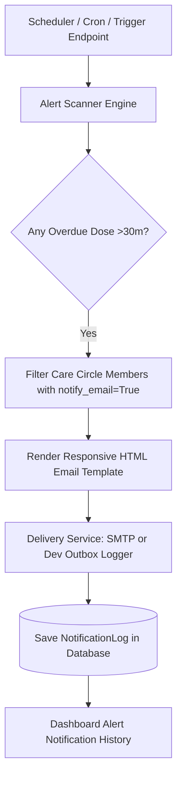

# Current Work Specification: Part 6 (Proactive Email Reminders & Missed Dose Alerts)

---

## 1. Objective & Scope

This document defines the complete technical and functional specification for **Part 6: Proactive Email Reminders & Missed Dose Alerts** of the Elderly Care & Medication Management Platform.

### Core Problem Solved:
Family members and caregivers cannot be physically present at all hours. When an elderly senior forgets a dose or becomes incapacitated, delays in medication (e.g., insulin, blood pressure regulators, cardiac meds) can cause severe medical crises.
Part 6 introduces an **automated notification and alert engine** that proactively dispatches clear, actionable email alerts for:
1. **Upcoming Dose Reminders:** Gentle reminders ahead of scheduled morning, afternoon, evening, or night medication routines.
2. **Critical Overdue / Missed Dose Escalations:** If a scheduled dose remains unlogged > 30 minutes after its target time, an urgent escalation is dispatched to all subscribed family members and caregivers in the senior's care circle.
3. **Upcoming Medical Appointment Alerts:** Reminder sent 24–48 hours prior to scheduled specialist visits with preparation instructions (fasting, documents).
4. **Interactive Demo Trigger ("Send Test Alert Now"):** Allows judges, family, and caregivers to test and preview email alerts on-demand with 1 click.

---

## 2. Notification Engine Architecture



---

## 3. Database Schema (SQLAlchemy Model)

File: `backend/app/models/notification.py`

```python
from datetime import datetime
from sqlalchemy import Column, Integer, String, DateTime, ForeignKey, Text, Boolean
from sqlalchemy.orm import relationship
from app.database import Base

class NotificationLog(Base):
    __tablename__ = "notification_logs"

    id = Column(Integer, primary_key=True, index=True)
    profile_id = Column(Integer, ForeignKey("elderly_profiles.id", ondelete="CASCADE"), nullable=False, index=True)
    recipient_user_id = Column(Integer, ForeignKey("users.id", ondelete="SET NULL"), nullable=True)

    recipient_email = Column(String(120), nullable=False)
    recipient_name = Column(String(100), nullable=False)
    alert_type = Column(String(40), nullable=False)  # "missed_dose_alert", "upcoming_dose_reminder", "appointment_reminder", "test_alert"
    subject = Column(String(200), nullable=False)
    message_content = Column(Text, nullable=False)
    status = Column(String(20), nullable=False, default="sent") # "sent", "failed", "simulated"
    sent_at = Column(DateTime, default=datetime.utcnow)

    profile = relationship("ElderlyProfile", backref="notification_logs")
    user = relationship("User")
```

---

## 4. Pydantic Schemas

File: `backend/app/schemas/notification.py`

```python
from datetime import datetime
from typing import Optional, List
from pydantic import BaseModel, ConfigDict, EmailStr

class SendTestAlertRequest(BaseModel):
    profile_id: int
    alert_type: str = "missed_dose_alert"  # 'missed_dose_alert', 'upcoming_dose_reminder', 'appointment_reminder'
    target_email: Optional[str] = None     # If omitted, sends to current user's email

class TriggerCheckAlertsRequest(BaseModel):
    profile_id: int

class NotificationLogResponse(BaseModel):
    model_config = ConfigDict(from_attributes=True)

    id: int
    profile_id: int
    recipient_email: str
    recipient_name: str
    alert_type: str
    subject: str
    message_content: str
    status: str
    sent_at: datetime

class AlertScanResult(BaseModel):
    profile_id: int
    scanned_at: datetime
    alerts_dispatched: int
    overdue_doses_found: int
    details: List[str]
```

---

## 5. REST API Endpoints Specification

Base URL: `http://localhost:8000/api/notifications`

### 1. `POST /api/notifications/test-alert`
* **Description:** Dispatches a formatted test email notification to family/caregiver or specified email address.
* **Request:** `SendTestAlertRequest`
* **Response:** `NotificationLogResponse`

### 2. `POST /api/notifications/scan-alerts`
* **Description:** Scans today's medication routine and upcoming appointments for the given profile. Detects overdue doses (>30m past target time with status `pending`) and dispatches escalation emails to circle members who have `notify_email = True`.
* **Request:** `TriggerCheckAlertsRequest`
* **Response:** `AlertScanResult`

### 3. `GET /api/notifications/history?profile_id={id}&limit=20`
* **Description:** Returns the recent alert log history for this senior profile so caregivers can audit all sent reminders.
* **Response:** `List[NotificationLogResponse]`

---

## 6. Frontend Architecture & UI Design

### 6.1 Alerts Quick Action Card & History Drawer
* **Demo-Friendly Quick Trigger:**
  * `[ 🔔 Send Test Missed-Dose Alert ]` button on the dashboard for instant testing.
  * Preview of the exact email sent (subject, recipient, timestamp, medicine details).
* **Alert History Drawer / Modal:**
  * Displays timeline of past dispatched reminders and escalations with status pills (*Sent ✅*, *Simulated ✉️*).

---

## 7. Automated Test Plan (`test_notifications_api.py`)

1. **Test 1:** Unauthenticated request rejected (401).
2. **Test 2:** Send test missed-dose alert for Grandpa Robert -> 200 OK.
3. **Test 3:** Verify notification logged in DB with recipient and alert type.
4. **Test 4:** Scan alerts for overdue medications -> returns `AlertScanResult`.
5. **Test 5:** Get notification history for profile -> returns list of logs.
6. **Test 6:** Read-only `other` role blocked from dispatching manual alert triggers (403 Forbidden).
7. **Test 7:** Profile isolation: Alice's notification logs are isolated from Robert's.

---

## 8. Definition of Done (Deliverables)

* [ ] `backend/app/models/notification.py` created and registered.
* [ ] `backend/app/schemas/notification.py` created and registered.
* [ ] `backend/app/services/email_service.py` created (responsive HTML email renderer + SMTP/dev delivery).
* [ ] `backend/app/routers/notification.py` implemented and registered.
* [ ] `backend/test_notifications_api.py` passing 100% of tests.
* [ ] Frontend types and API methods added in `frontend/src/lib/types.ts` & `frontend/src/lib/api.ts`.
* [ ] Frontend components: `AlertsBanner.tsx` and `NotificationHistoryModal.tsx`.
* [ ] Verified with `npx tsc --noEmit`.
