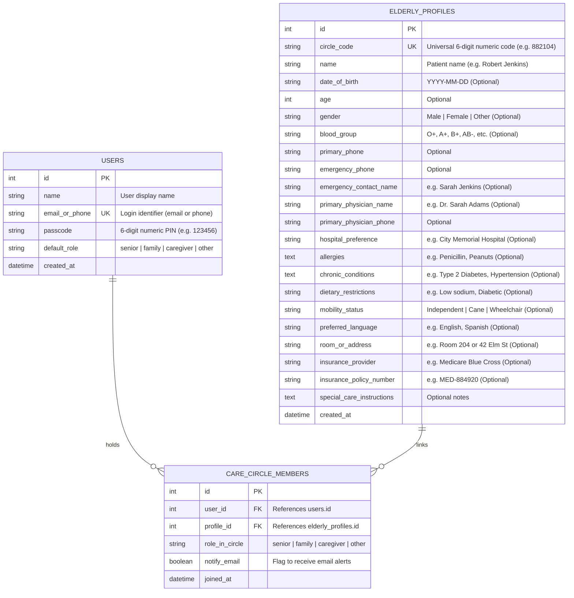

# Current Work Specification: Part 1 (Foundation) & Part 2 (Profiles & Passcode-Based Access)

---

## 1. Objective & Scope

This document serves as the exact blueprint and execution checklist for **Part 1 (Foundation & Setup)** and **Part 2 (Profiles & Passcode-Based Access)** of the Elderly Care & Medication Management Platform.

### Key Decisions Locked In:
1. **Uniform 2-Step Onboarding:** Every user (Senior, Family, Caregiver, Other) goes through the identical first step: **Sign up with Name + Email/Phone + 6-Digit Numeric Passcode**. Once inside, they can create a new Elderly Profile or join an existing one.
2. **Universal 6-Digit `circle_code`:** A single 6-digit numeric code (e.g., `882104`) is generated per Elderly Profile. Whether a senior invites family, or family invites a nurse, **the exact same code is used by everyone** to join the circle.
3. **Role-Based Access (Clean & Simple):**
   * `senior`: The focal patient (view routine, 1-tap mark doses taken/skipped, view appointments).
   * `family`: Family member (manage medications & appointments, mark doses, receive email alerts).
   * `caregiver`: Professional nurse or aide (full management and dose logging capabilities).
   * `other`: Read-only viewer (neighbor, relative; monitor without editing/logging rights).
4. **Rich Healthcare Profile (High-Impact UI):** Extensive optional medical fields on `ElderlyProfile` (allergies, blood group, chronic conditions, physician, insurance, mobility) to impress judges while keeping all fields non-blocking (`nullable=True`).
5. **1-Click Demo Switcher on Login:** Instant pre-seeded login buttons (`[👴 Grandpa Robert]`, `[👩 Daughter Sarah]`, `[🩺 Nurse Elena]`, `[👁️ Neighbor Tom]`) for effortless 10-second hackathon evaluations.
6. **Instant Profile Switching:** Seamless top-bar dropdown for family/caregivers caring for multiple seniors (e.g. Mom & Dad) with strict data separation.

---

## 2. Domain & Entity Architecture



---

## 3. Database Models (SQLAlchemy)

File: `backend/app/models/user_and_profile.py`

```python
from datetime import datetime
from sqlalchemy import Column, Integer, String, Text, Boolean, DateTime, ForeignKey, UniqueConstraint
from sqlalchemy.orm import relationship
from app.database import Base

class User(Base):
    __tablename__ = "users"

    id = Column(Integer, primary_key=True, index=True)
    name = Column(String(100), nullable=False)
    email_or_phone = Column(String(120), unique=True, index=True, nullable=False)
    passcode = Column(String(20), nullable=False)  # 6-digit numeric PIN (e.g., "123456")
    default_role = Column(String(20), default="family") # 'senior', 'family', 'caregiver', 'other'
    created_at = Column(DateTime, default=datetime.utcnow)

    memberships = relationship("CareCircleMember", back_populates="user", cascade="all, delete-orphan")


class ElderlyProfile(Base):
    __tablename__ = "elderly_profiles"

    id = Column(Integer, primary_key=True, index=True)
    # 6-digit universal numeric code for all invites to this circle (e.g., "882104")
    circle_code = Column(String(10), unique=True, index=True, nullable=False)
    name = Column(String(100), nullable=False)  # Patient full name (e.g., "Robert Jenkins")

    # Rich optional medical fields for judge evaluation
    date_of_birth = Column(String(20), nullable=True)
    age = Column(Integer, nullable=True)
    gender = Column(String(20), nullable=True)
    blood_group = Column(String(10), nullable=True) # "O+", "A+", etc.
    primary_phone = Column(String(30), nullable=True)
    emergency_phone = Column(String(30), nullable=True)
    emergency_contact_name = Column(String(100), nullable=True)
    primary_physician_name = Column(String(100), nullable=True)
    primary_physician_phone = Column(String(30), nullable=True)
    hospital_preference = Column(String(150), nullable=True)
    allergies = Column(Text, nullable=True)
    chronic_conditions = Column(Text, nullable=True)
    dietary_restrictions = Column(String(150), nullable=True)
    mobility_status = Column(String(50), nullable=True) # "Independent", "Cane", "Wheelchair"
    preferred_language = Column(String(50), default="English", nullable=True)
    room_or_address = Column(String(200), nullable=True)
    insurance_provider = Column(String(100), nullable=True)
    insurance_policy_number = Column(String(50), nullable=True)
    special_care_instructions = Column(Text, nullable=True)

    created_at = Column(DateTime, default=datetime.utcnow)

    members = relationship("CareCircleMember", back_populates="profile", cascade="all, delete-orphan")


class CareCircleMember(Base):
    __tablename__ = "care_circle_members"

    id = Column(Integer, primary_key=True, index=True)
    user_id = Column(Integer, ForeignKey("users.id", ondelete="CASCADE"), nullable=False)
    profile_id = Column(Integer, ForeignKey("elderly_profiles.id", ondelete="CASCADE"), nullable=False)
    role_in_circle = Column(String(20), nullable=False)  # 'senior', 'family', 'caregiver', 'other'
    notify_email = Column(Boolean, default=True)
    joined_at = Column(DateTime, default=datetime.utcnow)

    user = relationship("User", back_populates="memberships")
    profile = relationship("ElderlyProfile", back_populates="members")

    __table_args__ = (
        UniqueConstraint("user_id", "profile_id", name="uq_user_profile_circle"),
    )
```

---

## 4. Pydantic Schemas

File: `backend/app/schemas/auth_and_profile.py`

```python
from datetime import datetime
from typing import Optional, List
from pydantic import BaseModel, Field

# --- User & Authentication Schemas ---
class UserSignupRequest(BaseModel):
    name: str = Field(..., min_length=2, max_length=100, example="Sarah Jenkins")
    email_or_phone: str = Field(..., min_length=3, max_length=120, example="sarah@example.com")
    passcode: str = Field(..., min_length=6, max_length=6, pattern="^[0-9]{6}$", example="123456")
    default_role: str = Field("family", example="family")

class UserLoginRequest(BaseModel):
    email_or_phone: str = Field(..., example="sarah@example.com")
    passcode: str = Field(..., min_length=6, max_length=6, pattern="^[0-9]{6}$", example="123456")

class UserResponse(BaseModel):
    id: int
    name: str
    email_or_phone: str
    default_role: str
    created_at: datetime

    class Config:
        from_attributes = True

class AuthTokenResponse(BaseModel):
    access_token: str
    token_type: str = "bearer"
    user: UserResponse


# --- Elderly Profile Schemas ---
class ElderlyProfileCreate(BaseModel):
    name: str = Field(..., min_length=2, max_length=100, example="Robert Jenkins")
    date_of_birth: Optional[str] = Field(None, example="1948-05-12")
    age: Optional[int] = Field(None, ge=1, le=130, example=78)
    gender: Optional[str] = Field(None, example="Male")
    blood_group: Optional[str] = Field(None, example="O+")
    primary_phone: Optional[str] = Field(None, example="+1-555-0100")
    emergency_phone: Optional[str] = Field(None, example="+1-555-0199")
    emergency_contact_name: Optional[str] = Field(None, example="Sarah Jenkins (Daughter)")
    primary_physician_name: Optional[str] = Field(None, example="Dr. Sarah Adams")
    primary_physician_phone: Optional[str] = Field(None, example="+1-555-0222")
    hospital_preference: Optional[str] = Field(None, example="City Memorial Hospital")
    allergies: Optional[str] = Field(None, example="Penicillin, Peanuts")
    chronic_conditions: Optional[str] = Field(None, example="Type 2 Diabetes, Hypertension")
    dietary_restrictions: Optional[str] = Field(None, example="Low sodium, Diabetic")
    mobility_status: Optional[str] = Field(None, example="Independent")
    preferred_language: Optional[str] = Field("English", example="English")
    room_or_address: Optional[str] = Field(None, example="42 Elm St, Apt 3B")
    insurance_provider: Optional[str] = Field(None, example="Medicare Blue Shield")
    insurance_policy_number: Optional[str] = Field(None, example="MED-884920")
    special_care_instructions: Optional[str] = Field(None, example="Needs glasses for reading. Speaks slowly.")
    role_in_circle: str = Field("family", example="family")

class ElderlyProfileResponse(BaseModel):
    id: int
    circle_code: str
    name: str
    date_of_birth: Optional[str]
    age: Optional[int]
    gender: Optional[str]
    blood_group: Optional[str]
    primary_phone: Optional[str]
    emergency_phone: Optional[str]
    emergency_contact_name: Optional[str]
    primary_physician_name: Optional[str]
    primary_physician_phone: Optional[str]
    hospital_preference: Optional[str]
    allergies: Optional[str]
    chronic_conditions: Optional[str]
    dietary_restrictions: Optional[str]
    mobility_status: Optional[str]
    preferred_language: Optional[str]
    room_or_address: Optional[str]
    insurance_provider: Optional[str]
    insurance_policy_number: Optional[str]
    special_care_instructions: Optional[str]
    created_at: datetime

    class Config:
        from_attributes = True


# --- Care Circle Connections Schemas ---
class JoinCareCircleRequest(BaseModel):
    circle_code: str = Field(..., min_length=6, max_length=6, pattern="^[0-9]{6}$", example="882104")
    role_in_circle: str = Field("family", example="family") # 'senior', 'family', 'caregiver', 'other'

class AccessibleProfileSummary(BaseModel):
    profile_id: int
    circle_code: str
    name: str
    age: Optional[int]
    gender: Optional[str]
    blood_group: Optional[str]
    role_in_circle: str
    notify_email: bool

class CircleMemberDetail(BaseModel):
    user_id: int
    name: str
    email_or_phone: str
    role_in_circle: str
    notify_email: bool
    joined_at: datetime
```

---

## 5. REST API Endpoints Specification

Base URL: `http://localhost:8000/api`

### 5.1 Authentication (`/api/auth`)

* `POST /api/auth/signup`: Create user account with 6-digit passcode.
* `POST /api/auth/login`: Authenticate with `email_or_phone` + 6-digit `passcode`.
* `GET /api/auth/me`: Get current authenticated user profile.
* `POST /api/auth/demo-login/{role}`: 1-click login endpoint for demo evaluation (`grandpa`, `sarah`, `elena`, `tom`).

### 5.2 Profiles & Care Circle (`/api/profiles`)

* `POST /api/profiles`: Creates new elderly profile with full medical details and generates a 6-digit `circle_code`. Automatically connects creator as a member.
* `GET /api/profiles/my`: Returns all profiles the user belongs to (powers the topbar switcher).
* `GET /api/profiles/{id}`: Returns complete healthcare details for the elderly person (vitals, physician, allergies).
* `POST /api/profiles/join`: Connects user to a care circle via 6-digit `circle_code`.
* `GET /api/profiles/{id}/members`: Lists all members connected to this senior's care circle.

---

## 6. Frontend UX & 1-Click Demo Switcher

### 6.1 Login Page with 1-Click Demo Buttons
```
┌────────────────────────────────────────────────────────┐
│               Elderly Care Platform                    │
│                                                        │
│  [ Demo Quick Login (Click to test any persona) ]      │
│  ┌──────────────┐ ┌──────────────┐ ┌──────────────┐    │
│  │ 👴 Grandpa    │ │ 👩 Daughter   │ │ 🩺 Nurse     │    │
│  │ (Senior Mode)│ │ (Family Admin│ │ (Caregiver)  │    │
│  └──────────────┘ └──────────────┘ └──────────────┘    │
│                                                        │
│  ─────────────── OR LOGIN WITH PIN ──────────────────  │
│  Email or Phone: [ sarah@example.com                ]  │
│  6-Digit Passcode: [ ● ● ● ● ● ● ]                     │
│  [ Touch PIN Pad (1-9) ]                               │
│  [ LOGIN BUTTON ]                                      │
└────────────────────────────────────────────────────────┘
```

### 6.2 Top Bar Profile Switcher Dropdown
```
┌────────────────────────────────────────────────────────────────────────┐
│  CarePlatform        [ 👴 Robert Jenkins (882104) ▼ ]       Sarah 👩   │
└────────────────────────────────────────────────────────────────────────┘
                       │
                       ▼ Dropdown Menu
                       ├── ✅ 👴 Robert Jenkins (Code: 882104) - Role: Family
                       ├──    👵 Alice Jenkins  (Code: 994821) - Role: Family
                       ├── ───────────────────────────────────────────────
                       ├── ➕ Create New Senior Profile
                       └── 🔗 Join Circle with 6-Digit Code
```

---

## 7. Step-by-Step Implementation Plan

### Step 1: Backend Setup & Models
- Create `backend/` files:
  - `requirements.txt`
  - `app/main.py`
  - `app/database.py`
  - `app/models/user_and_profile.py`
  - `app/schemas/auth_and_profile.py`
  - `app/routers/auth.py`
  - `app/routers/profiles.py`
  - `app/utils/seeder.py` (Seeds Grandpa Robert `882104`, Grandma Alice `994821`, Sarah, Nurse Elena, and Neighbor Tom with PIN `123456`).

### Step 2: Backend Test & Verification
- Run FastAPI server.
- Run automated verification script checking signup, login, demo login, profile creation, circle joining, and profile switcher endpoints.

### Step 3: Frontend Setup & Next.js Foundation
- Initialize Next.js in `frontend/` with Tailwind CSS, Lucide icons.
- Create API client `src/lib/api.ts` with token handling.
- Create `AuthContext` and `ActiveProfileContext`.

### Step 4: Frontend UI (Auth, Profile Switcher & Detail Modal)
- Build `/login` with 1-Click Demo Persona buttons + PIN Pad.
- Build `/signup` page.
- Build `Header` with dynamic `ProfileSwitcher` dropdown.
- Build `Dashboard` showing the active senior's full healthcare card (blood group, allergies, physician, circle code) and connected circle members.
