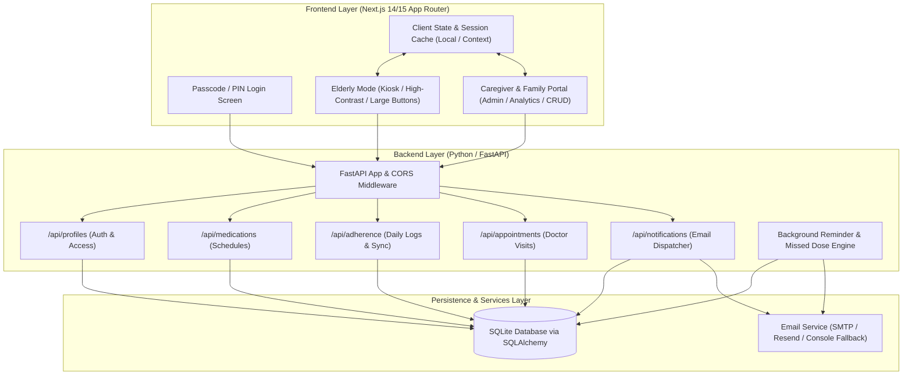
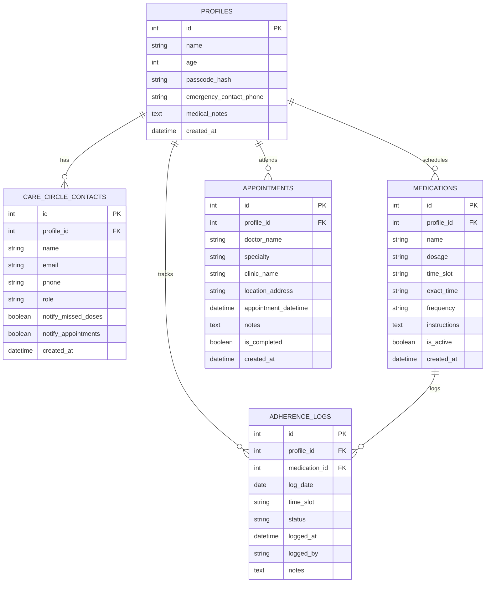
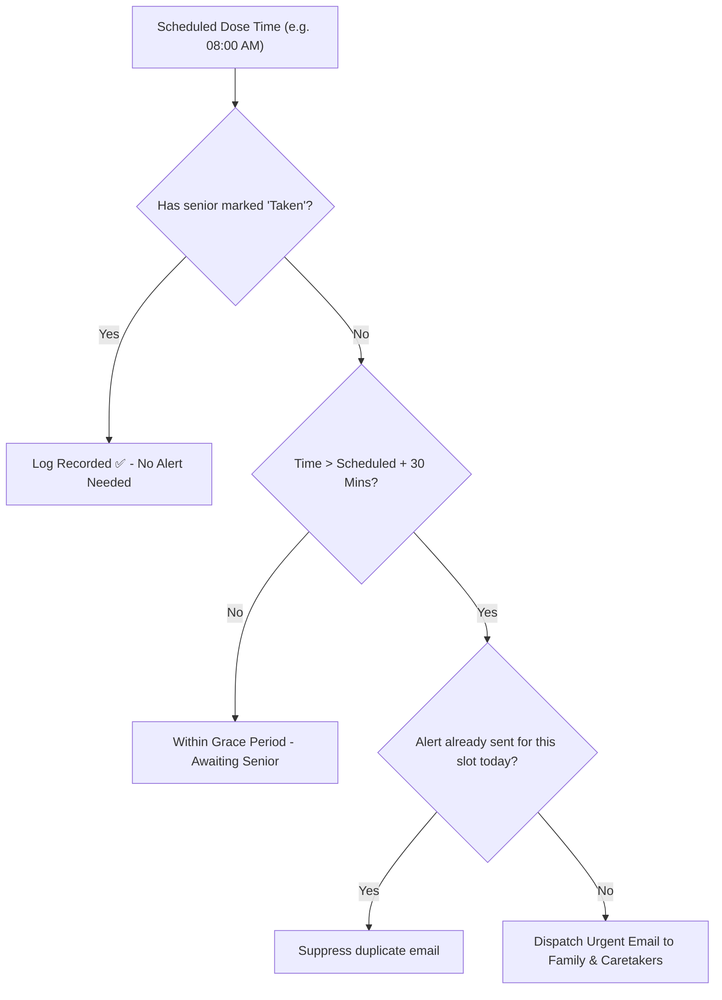

# Global Technical Design Document (TDD)
## Elderly Care & Medication Management Platform

---

## 1. System Overview & Architecture

The **Elderly Care & Medication Management Platform** is a collaborative healthcare ecosystem designed for three user roles: **Elderly Individuals**, **Family Members**, and **Caretakers**. The system prioritizes simplicity, rapid response times, and bulletproof reliability for a 12-hour hackathon execution.

### High-Level Architecture Diagram



---

## 2. Monorepo Project Structure

```
Elderly-Care-Medication-Management-Platform/
├── backend/
│   ├── app/
│   │   ├── __init__.py
│   │   ├── main.py                  # FastAPI entry point, CORS, routers include
│   │   ├── config.py                # Pydantic Settings, environment variables
│   │   ├── database.py              # SQLite engine, sessionmaker, Base class
│   │   ├── models/                  # SQLAlchemy ORM database models
│   │   │   ├── __init__.py
│   │   │   ├── profile.py
│   │   │   ├── medication.py
│   │   │   ├── adherence.py
│   │   │   ├── appointment.py
│   │   │   └── contact.py
│   │   ├── schemas/                 # Pydantic request & response schemas
│   │   │   ├── __init__.py
│   │   │   ├── profile.py
│   │   │   ├── medication.py
│   │   │   ├── adherence.py
│   │   │   ├── appointment.py
│   │   │   └── notification.py
│   │   ├── routers/                 # API endpoint handlers
│   │   │   ├── __init__.py
│   │   │   ├── profiles.py
│   │   │   ├── medications.py
│   │   │   ├── adherence.py
│   │   │   ├── appointments.py
│   │   │   └── notifications.py
│   │   ├── services/                # Business logic & background workers
│   │   │   ├── __init__.py
│   │   │   ├── email_service.py     # HTML email builder and SMTP/Resend sender
│   │   │   └── scheduler_service.py # Missed-dose detector and notification scheduler
│   │   └── utils/
│   │       ├── __init__.py
│   │       └── seeder.py            # Quick seed script for rich demo data
│   ├── requirements.txt
│   └── .env.example
├── frontend/
│   ├── src/
│   │   ├── app/
│   │   │   ├── layout.tsx           # Global HTML shell & font providers
│   │   │   ├── page.tsx             # Root page (PIN login & profile selection)
│   │   │   ├── dashboard/
│   │   │   │   └── page.tsx         # Main dashboard container (Dual-Mode switcher)
│   │   │   └── onboarding/
│   │   │       └── page.tsx         # New profile setup flow
│   │   ├── components/
│   │   │   ├── elderly/
│   │   │   │   ├── ElderlyView.tsx       # Big button today's routine
│   │   │   │   ├── DoseCard.tsx          # 1-tap Take / Skip card
│   │   │   │   └── AppointmentBanner.tsx # High contrast appointment widget
│   │   │   ├── caregiver/
│   │   │   │   ├── CaregiverView.tsx     # Full management dashboard
│   │   │   │   ├── MedicationManager.tsx # CRUD table & modal
│   │   │   │   ├── AppointmentList.tsx   # Appointment manager
│   │   │   │   ├── AdherenceStats.tsx    # Compliance bar & weekly log
│   │   │   │   └── CareCircleSettings.tsx# Email alert recipients
│   │   │   └── shared/
│   │   │       ├── Header.tsx            # Mode switcher & profile info
│   │   │       ├── PinPad.tsx            # Touch-friendly PIN pad
│   │   │       └── Modal.tsx             # Accessible dialog wrapper
│   │   ├── lib/
│   │   │   ├── api.ts               # Axios / Fetch client for FastAPI
│   │   │   ├── types.ts             # TypeScript interfaces matching Pydantic
│   │   │   └── utils.ts             # Date formatters, time slot helpers
│   ├── package.json
│   ├── tsconfig.json
│   └── tailwind.config.ts
└── docs/
    ├── doc.txt                      # Original hackathon challenge brief
    ├── PROJECT_PLAN.md              # 7 small parts breakdown + innovations
    └── TECHNICAL_DESIGN_DOCUMENT.md # This document
```

---

## 3. Database Schema & Data Models

The database is built on **SQLite** with **SQLAlchemy ORM** for speed and zero configuration overhead during development.

### Entity Relationship Diagram (ERD)



### Table Definitions & Field Types

#### 1. `profiles`
| Column | Type | Constraints | Description |
| :--- | :--- | :--- | :--- |
| `id` | Integer | Primary Key, Auto-increment | Unique elderly profile identifier |
| `name` | String(100) | Not Null | Elderly person's full name (e.g., "Grandpa Robert") |
| `age` | Integer | Nullable | Age in years |
| `passcode` | String(6) | Not Null | 4-to-6 digit numeric access PIN |
| `emergency_contact_phone`| String(20) | Nullable | Primary contact number |
| `medical_notes` | Text | Nullable | Allergies, blood type, primary doctor name |
| `created_at` | DateTime | Default UTC now | Profile creation timestamp |

#### 2. `care_circle_contacts`
| Column | Type | Constraints | Description |
| :--- | :--- | :--- | :--- |
| `id` | Integer | Primary Key, Auto-increment | Contact ID |
| `profile_id` | Integer | Foreign Key (`profiles.id`), Cascade Delete | Associated elderly profile |
| `name` | String(100) | Not Null | Caretaker/Family member name |
| `email` | String(120) | Not Null | Email address for proactive notifications |
| `phone` | String(20) | Nullable | Phone number |
| `role` | String(20) | Not Null | `family` or `caretaker` |
| `notify_missed_doses` | Boolean | Default True | Receive alert if senior misses a dose |
| `notify_appointments` | Boolean | Default True | Receive appointment reminders |
| `created_at` | DateTime | Default UTC now | Registration timestamp |

#### 3. `medications`
| Column | Type | Constraints | Description |
| :--- | :--- | :--- | :--- |
| `id` | Integer | Primary Key, Auto-increment | Medication ID |
| `profile_id` | Integer | Foreign Key (`profiles.id`), Cascade Delete | Associated elderly profile |
| `name` | String(100) | Not Null | Name of medicine (e.g., "Metformin", "Lisinopril") |
| `dosage` | String(50) | Not Null | Dosage strength (e.g., "500 mg", "1 tablet") |
| `time_slot` | String(20) | Not Null | Canonical slot: `morning`, `afternoon`, `evening`, `night` |
| `exact_time` | String(5) | Default "08:00" | Scheduled time string in 24h format (`HH:MM`) |
| `frequency` | String(30) | Default "daily" | `daily`, `twice_daily`, `weekly`, `as_needed` |
| `instructions` | Text | Nullable | e.g., "Take with a glass of water after meal" |
| `is_active` | Boolean | Default True | Active status for ongoing prescriptions |
| `created_at` | DateTime | Default UTC now | Timestamp |

#### 4. `adherence_logs`
| Column | Type | Constraints | Description |
| :--- | :--- | :--- | :--- |
| `id` | Integer | Primary Key, Auto-increment | Log record ID |
| `profile_id` | Integer | Foreign Key (`profiles.id`), Cascade Delete | Associated elderly profile |
| `medication_id` | Integer | Foreign Key (`medications.id`), Cascade Delete| Associated medication |
| `log_date` | Date | Not Null | Date of dose event (`YYYY-MM-DD`) |
| `time_slot` | String(20) | Not Null | `morning`, `afternoon`, `evening`, `night` |
| `status` | String(20) | Not Null | `taken`, `skipped`, `pending` |
| `logged_at` | DateTime | Nullable | Exact timestamp when dose was taken/skipped |
| `logged_by` | String(20) | Default "senior" | Who logged it: `senior`, `caretaker`, `system` |
| `notes` | Text | Nullable | Reason if skipped (e.g., "Stomach upset") |

#### 5. `appointments`
| Column | Type | Constraints | Description |
| :--- | :--- | :--- | :--- |
| `id` | Integer | Primary Key, Auto-increment | Appointment ID |
| `profile_id` | Integer | Foreign Key (`profiles.id`), Cascade Delete | Associated elderly profile |
| `doctor_name` | String(100) | Not Null | Name of doctor (e.g., "Dr. Sarah Adams") |
| `specialty` | String(100) | Nullable | e.g., "Cardiology", "General Physician" |
| `clinic_name` | String(150) | Nullable | e.g., "Memorial Health Clinic" |
| `location_address` | String(255) | Nullable | Address or room number |
| `appointment_datetime`| DateTime | Not Null | Scheduled appointment date and time |
| `notes` | Text | Nullable | Instructions (e.g., "Fasting blood sugar test") |
| `is_completed` | Boolean | Default False | Status flag |
| `created_at` | DateTime | Default UTC now | Timestamp |

---

## 4. REST API Specification

### Base URL: `http://localhost:8000/api`

### 4.1 Profiles & Access Control

#### `POST /api/profiles`
Create a new elderly profile.
* **Request Body:**
  ```json
  {
    "name": "Grandpa Robert",
    "age": 78,
    "passcode": "1234",
    "emergency_contact_phone": "+1-555-0199",
    "medical_notes": "Allergic to Penicillin. Type 2 Diabetes."
  }
  ```
* **Response (201 Created):**
  ```json
  {
    "id": 1,
    "name": "Grandpa Robert",
    "age": 78,
    "passcode": "1234",
    "emergency_contact_phone": "+1-555-0199",
    "medical_notes": "Allergic to Penicillin. Type 2 Diabetes.",
    "created_at": "2026-11-15T11:00:00Z"
  }
  ```

#### `POST /api/profiles/login`
Validate PIN access for elderly or family member.
* **Request Body:**
  ```json
  {
    "profile_id": 1,
    "passcode": "1234"
  }
  ```
* **Response (200 OK):**
  ```json
  {
    "success": true,
    "profile": {
      "id": 1,
      "name": "Grandpa Robert",
      "age": 78
    },
    "token": "profile-1-access"
  }
  ```
* **Response (401 Unauthorized):**
  ```json
  { "detail": "Invalid profile ID or passcode." }
  ```

#### `GET /api/profiles`
List available profiles for quick demo switching.
* **Response (200 OK):** Array of profiles with basic info (`id`, `name`, `age`).

#### `GET /api/profiles/{id}`
Retrieve full profile info including care circle contacts count and active medications count.

---

### 4.2 Care Circle Contacts

#### `GET /api/profiles/{id}/contacts`
List all designated family members and caretakers for alerts.
* **Response (200 OK):**
  ```json
  [
    {
      "id": 1,
      "profile_id": 1,
      "name": "Sarah Jenkins",
      "email": "sarah.jenkins@example.com",
      "phone": "+1-555-0245",
      "role": "family",
      "notify_missed_doses": true,
      "notify_appointments": true
    }
  ]
  ```

#### `POST /api/profiles/{id}/contacts`
Add a new family member or caretaker.
* **Request Body:**
  ```json
  {
    "name": "Nurse David",
    "email": "david.care@example.com",
    "phone": "+1-555-0321",
    "role": "caretaker",
    "notify_missed_doses": true,
    "notify_appointments": false
  }
  ```

#### `DELETE /api/profiles/{id}/contacts/{contact_id}`
Remove a contact from the Care Circle.

---

### 4.3 Medications Management

#### `GET /api/medications?profile_id={id}`
List all active medications for an elderly individual.
* **Response (200 OK):**
  ```json
  [
    {
      "id": 10,
      "profile_id": 1,
      "name": "Metformin",
      "dosage": "500 mg",
      "time_slot": "morning",
      "exact_time": "08:00",
      "frequency": "daily",
      "instructions": "Take with breakfast",
      "is_active": true
    },
    {
      "id": 11,
      "profile_id": 1,
      "name": "Lisinopril",
      "dosage": "10 mg",
      "time_slot": "evening",
      "exact_time": "20:00",
      "frequency": "daily",
      "instructions": "Take before dinner with water",
      "is_active": true
    }
  ]
  ```

#### `POST /api/medications`
Create a new medication schedule entry.
* **Request Body:**
  ```json
  {
    "profile_id": 1,
    "name": "Atorvastatin",
    "dosage": "20 mg",
    "time_slot": "night",
    "exact_time": "21:30",
    "frequency": "daily",
    "instructions": "Take at bedtime",
    "is_active": true
  }
  ```

#### `PUT /api/medications/{id}`
Update medication details.

#### `DELETE /api/medications/{id}`
Soft-delete or deactivate a medication (`is_active = false`).

---

### 4.4 Adherence Tracking & Today's Schedule

#### `GET /api/adherence/today?profile_id={id}`
Returns the resolved daily routine for today (`YYYY-MM-DD`), matching scheduled medications with their logged adherence status.
* **Response (200 OK):**
  ```json
  {
    "date": "2026-11-15",
    "profile_id": 1,
    "summary": {
      "total_doses": 3,
      "taken_count": 2,
      "skipped_count": 0,
      "pending_count": 1,
      "completion_percentage": 67
    },
    "slots": {
      "morning": [
        {
          "medication_id": 10,
          "name": "Metformin",
          "dosage": "500 mg",
          "exact_time": "08:00",
          "instructions": "Take with breakfast",
          "status": "taken",
          "logged_at": "2026-11-15T08:14:22Z"
        }
      ],
      "afternoon": [],
      "evening": [
        {
          "medication_id": 11,
          "name": "Lisinopril",
          "dosage": "10 mg",
          "exact_time": "20:00",
          "instructions": "Take before dinner with water",
          "status": "pending",
          "logged_at": null
        }
      ],
      "night": [
        {
          "medication_id": 12,
          "name": "Atorvastatin",
          "dosage": "20 mg",
          "exact_time": "21:30",
          "instructions": "Take at bedtime",
          "status": "pending",
          "logged_at": null
        }
      ]
    }
  }
  ```

#### `POST /api/adherence/log`
Update adherence state when a pill is taken or skipped.
* **Request Body:**
  ```json
  {
    "profile_id": 1,
    "medication_id": 11,
    "time_slot": "evening",
    "status": "taken",
    "notes": ""
  }
  ```
* **Response (200 OK):**
  ```json
  {
    "success": true,
    "log_id": 44,
    "status": "taken",
    "logged_at": "2026-11-15T19:55:10Z"
  }
  ```

#### `GET /api/adherence/history?profile_id={id}&days=7`
Returns the historical adherence statistics for the last 7 days for the Caregiver chart.

---

### 4.5 Medical Appointments

#### `GET /api/appointments?profile_id={id}`
Returns all upcoming appointments sorted by date/time ascending, plus completed ones.
* **Response (200 OK):**
  ```json
  [
    {
      "id": 5,
      "profile_id": 1,
      "doctor_name": "Dr. Sarah Adams",
      "specialty": "Cardiology",
      "clinic_name": "City Heart Center",
      "location_address": "Suite 400, 100 Main St.",
      "appointment_datetime": "2026-11-18T10:30:00Z",
      "notes": "Bring recent ECG report and blood pressure log",
      "is_completed": false
    }
  ]
  ```

#### `POST /api/appointments`
Schedule a new doctor appointment.
* **Request Body:**
  ```json
  {
    "profile_id": 1,
    "doctor_name": "Dr. Mark Thorne",
    "specialty": "Ophthalmology",
    "clinic_name": "Vision Care Clinic",
    "location_address": "250 Park Ave.",
    "appointment_datetime": "2026-11-25T14:00:00Z",
    "notes": "Annual dilated eye exam"
  }
  ```

#### `DELETE /api/appointments/{id}`
Cancel an appointment.

---

### 4.6 Notifications & Proactive Alerts

#### `POST /api/notifications/check-alerts`
Evaluates missed doses and sends proactive emails. Called by background scheduler or manual test trigger.
* **Response (200 OK):**
  ```json
  {
    "alerts_evaluated": 3,
    "emails_dispatched": 1,
    "details": [
      {
        "profile": "Grandpa Robert",
        "medication": "Lisinopril",
        "recipient": "sarah.jenkins@example.com",
        "reason": "Dose overdue by 45 minutes"
      }
    ]
  }
  ```

#### `POST /api/notifications/test-email`
Sends an immediate test email to verify credentials and template rendering.
* **Request Body:**
  ```json
  {
    "recipient_email": "test@example.com",
    "subject": "Test Alert - Elderly Care Platform",
    "type": "missed_dose_preview"
  }
  ```

---

## 5. Proactive Notification Engine & Email Templates

### 5.1 Alert Logic & Escalation Rules



### 5.2 Email Architecture

1. **Provider Setup:**
   * **Development / Demo Mode:** Python `smtplib` + local logging, or a real free provider like **Resend** (via API key) or **Gmail App Password / Mailtrap**.
   * Fallback console logger ensures that even if credentials are not configured, the entire alert payload is clearly visible in the backend terminal.
2. **Key Email Types:**
   * **Missed Dose Alert:**
     * **Subject:** `⚠️ Action Needed: [Senior Name] missed their [Slot] medication ([Medicine Name])`
     * **Body:** Highlights exact dose name, scheduled time, time elapsed, and provides a direct 1-click link to check the dashboard or call the senior.
   * **Upcoming Appointment Reminder:**
     * **Subject:** `📅 Reminder: [Senior Name]'s appointment with [Doctor Name] tomorrow at [Time]`
     * **Body:** Includes doctor name, specialty, clinic address, and preparation notes.

---

## 6. Frontend Architecture (Next.js)

### 6.1 State Management & Role Switching

* **Session Storage:** Active Profile ID stored in browser `localStorage` under `care_active_profile_id`.
* **View Mode State:** Persistent toggle `care_view_mode`:
  * `'elderly'` — Elderly Mode (Minimalist, Kiosk)
  * `'caregiver'` — Caregiver & Family Portal

### 6.2 Component Hierarchy

```
App Shell (layout.tsx)
 ├── Top Navigation Header (Header.tsx)
 │    ├── Profile Selector & Avatar
 │    ├── PIN Lock / Logout Button
 │    └── Mode Switcher (Elderly Mode 👴 ↔ Caregiver Mode 👨‍⚕️)
 │
 ├── If ViewMode === 'elderly':
 │    └── ElderlyView.tsx
 │         ├── Greeting & Big Clock ("Good Morning, Grandpa Robert!")
 │         ├── Today's Adherence Summary Bar ("2 of 3 taken")
 │         ├── Time-Slot Accordion / Cards (Morning, Afternoon, Evening, Night)
 │         │    └── DoseCard.tsx
 │         │         ├── Medicine Name (text-2xl, font-bold)
 │         │         ├── Instructions ("With food", visual pill icon)
 │         │         └── Large Touch Action Buttons ("I Took This ✅", "Skip")
 │         └── Upcoming Appointment Alert Banner
 │
 └── If ViewMode === 'caregiver':
      └── CaregiverView.tsx
           ├── Tabs Navigation:
           │    ├── [Tab 1] Daily Routine (Overview & Live Status)
           │    ├── [Tab 2] Medications (CRUD Table + "Add Medicine" Dialog)
           │    ├── [Tab 3] Appointments (Upcoming visits + "New Visit" Dialog)
           │    ├── [Tab 4] Adherence Log (Past 7-day adherence history & score)
           │    └── [Tab 5] Care Circle (Family & Caregiver Email Notifications)
           └── Quick Action Floating Buttons
```

---

## 7. Security, Reliability & Error Handling

1. **Passcode Access:**
   * Passcodes are 4-to-6 numeric digits.
   * Simple validation endpoint with rate limiting to prevent brute-forcing.
2. **CORS Policy:**
   * FastAPI configured with permissive CORS for `http://localhost:3000` (Next.js default) and local IP addresses.
3. **Data Integrity:**
   * Foreign keys configured with `ON DELETE CASCADE` so deleting a profile cleans up its associated logs and medications.
   * Unique constraint on `adherence_logs` per `(profile_id, medication_id, log_date, time_slot)` to prevent duplicate log records for the same day/slot.

---

## 8. Verification & Demo Readiness Plan

To enable instant grading and presentation during the 12-hour hackathon:
* **Built-in Seeder (`backend/app/utils/seeder.py`):**
  * Populates a realistic demo profile ("Grandpa Robert", age 78, PIN: `1234`).
  * Seeds 3 daily medications (Morning Metformin, Evening Lisinopril, Night Atorvastatin).
  * Seeds 1 upcoming Cardiology appointment for the week.
  * Seeds 2 Care Circle contacts (daughter "Sarah Jenkins" and nurse "David").
  * Seeds sample adherence history so the dashboard immediately shows realistic compliance charts.
